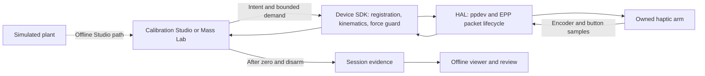

<div align="center">

# visiontouch-rs

### A clean-room Rust host stack for a haptic arm

[](docs/charter.md)
[](Cargo.toml)
[](https://github.com/DreamLab-AI/VisionFlow)

**Force you can feel, only after it has been measured.**

**Maintainer**: [John O'Hare](https://github.com/jjohare)

[Where it sits](#where-visiontouch-rs-sits) · [Status](#status) · [Running](#running) · [Safety](#safety) · [Reading order](#reading-order) · [Legal](#legal-summary)

</div>

---

A clean-room Rust host stack, on Linux, for a 1990s **SensAble PHANTOM 1.0A**
haptic arm that connects over an IEEE-1284 EPP parallel cable. The vendor stack
ran on Windows 98/NT and is out of support; this repository recovers the host
side by observation and reimplements it independently: transport, device SDK,
force models, a calibration and force-verification studio, a physics sandbox and
an offline workspace viewer.

This is a lab evaluation, formally part of the DreamLab
[VisionFlow](https://github.com/DreamLab-AI/VisionFlow) research estate: a
private proof of principle with no economic use, built as a study for the lab's
installation and, later, as a pose-and-button input for selecting nodes in the
VisionClaw graph. The intended written output is an academic paper. The
repository is not affiliated with, endorsed by, or derived from code belonging to
SensAble Technologies, Geomagic or 3D Systems; product names identify the hardware
being studied.

---

## Where visiontouch-rs sits

visiontouch-rs is a supporting study in the [VisionFlow](https://github.com/DreamLab-AI/VisionFlow) estate, listed in its [repository map](https://github.com/DreamLab-AI/VisionFlow/blob/main/docs/architecture/repository-map.md) and [ecosystem map](https://github.com/DreamLab-AI/VisionFlow/blob/main/docs/ecosystem-map.md). It is a proof of principle, not a runtime the other repositories depend on.

| Sibling | Relationship |
|:--------|:-------------|
| **[VisionFlow](https://github.com/DreamLab-AI/VisionFlow)** | Coordination canon. Records this repository as a private supporting study; source and offline tests here do not establish hardware acceptance or delivered force. |
| **[VisionClaw](https://github.com/DreamLab-AI/VisionClaw)** | Intended later consumer: a 6-DoF pose and button input for selecting nodes in the graph. Nothing is wired and no interface is committed. |
| **[Codescape](https://github.com/DreamLab-AI/codescape)** | A possible later consumer through the same node-selection input, as Codescape shares VisionClaw's position wire. Not planned or built. |

---

## Status

**Reviewed 21 October 2026 at committed revision `6402fbe`.** The last README change was 19 October; the next commit only re-stamped a decision record. The current worktree also contains unfinished Calibration Studio/onboarding edits. Those edits are not a new hardware acceptance result, and this review has not opened the device.


| Area | State |
|---|---|
| Transport (software EPP over ppdev) | Verified live: setup, 16-byte packets, six encoder counters, stylus button, zero-only arming handshake, acknowledged motor packets (P-0021 to P-0030) |
| Kinematic model | Reference model (L = 0.1397 m) reproduces the vendor fixture; origin is the published reset pose; link lengths not independently measured |
| Delivered force | **Unmeasured.** The 2026-10-16 envelope commanded less than backdrive friction and released output after 0.6 s (P-0060). The rebuilt envelope and the staged verification ladder in `docs/spec/14-force-calibration.md` are offline-tested and await the owner's attended session |
| Wrist (gimbal) | Three encoders read; no torque output |
| Real time | About 420 Hz servo on the owner's host, no deadline misses observed in short runs; no hard real-time claim |

## Architecture



The worker owns device I/O; the interface sends intent. A commanded value in the SDK is a model output, not measured force. The future graph-input path remains a proposal with no committed integration interface.

## Layout

```
crates/hal          ppdev transport, EPP cycles, packet and motor-session lifecycle, channel clamp
crates/device       SDK: encoder state, reset-pose registration, kinematics, ForceGuard, Demand
crates/effects      hardware-free force models for demos
apps/calibration    Calibration Studio: registration, staged force verification, demos, evidence
apps/mass-lab       physics sandbox with servo-rate force coupling
apps/workspace-viewer  offline Three.js reconstruction and replay of recorded sweeps
tools/              port-probe, port-recorder, device-readout crates; audio analysis
scripts/            launchers, with-port-access, quality-gate.sh, adr-index-gen.cjs
docs/               governing document, ADR ledger, specs, research, legal, clean-room, evidence
archive/            gitignored local holding area
```

## Running

Start without hardware. These commands exercise the toolchain, simulator or recorded data:

```sh
scripts/quality-gate.sh
scripts/run-calibration --demo
scripts/run-mass-lab --no-device
scripts/run-workspace-viewer
```

The viewer serves at `http://127.0.0.1:8765`. The [Studio guide](apps/calibration/README.md) and [guided-session specification](docs/spec/16-guided-onboarding.md) explain registration, current step state and evidence. A simulator result cannot clear a physical calibration requirement.

<details>
<summary><strong>Owner-host hardware path</strong></summary>

Physical tests are attended and run on the owner's host, following the [force-verification runbook](docs/spec/14-force-calibration.md). They are separate from the commands above and from CI.

```sh
scripts/run-calibration  # connects input-only; a held verification step is required for output
cargo build -p device-readout
scripts/with-port-access timeout -s KILL 10s target/debug/device-readout /dev/parport0 50
```

`scripts/with-port-access` re-executes a command with the invoking user's current
groups so the `lp`-owned device node is accessible without a reboot.

</details>

## Calibration and force verification

The Studio follows the practice published for this device family
(`docs/research/historical-calibration-practice.md`): register the arm at the
reset pose (near arm horizontal and square to the base front, far arm plumb),
check registration with a ruler and a gravity drop, then verify force output by
stages, each a held attempt that writes an evidence record: actuator liveness,
per-axis sign pulses, a static ladder against a gauge or scale (0.1 to 2.0 N),
a differential lift test with known masses, a virtual-wall stiffness ramp and a
thermal hold. Each stage unlocks the next only after the operator's readings clear
the rung on the current connection. Mass Lab runs at the P-0030 default (0.5 N, 96 counts) and never above
`CONTINUOUS_FORCE_N`; only the Studio's effects are ladder-gated. The owner's runbook is the appendix of
`docs/spec/14-force-calibration.md`.

## Safety

The device applies force to a hand. Motor output is explicitly armed per attempt,
expires to zero after 25 ms without a fresh request, and is clamped at the
transport to 300 counts of a 2047-centred word (about 15% of the half-span). Applications
inherit a 0.5 N / 96-count default. Software cannot cover a kernel stall or a
killed process; keep the amplifier power switch within reach and nothing in the
workspace during powered steps.

## Reading order

| Doc | What it is |
|---|---|
| [docs/BASELINE-visiontouch-rs.md](docs/BASELINE-visiontouch-rs.md) | Governing document: invariants and change process |
| [docs/adr/README.md](docs/adr/README.md) | Decision ledger |
| [docs/spec/14-force-calibration.md](docs/spec/14-force-calibration.md) | Registration, verification ladder, evidence schema, runbook |
| [docs/spec/12-force-feedback.md](docs/spec/12-force-feedback.md) | Observed output lifecycle, force model, envelope |
| [docs/spec/10-device-readout.md](docs/spec/10-device-readout.md) | Transport and packet decoding |
| [docs/research/historical-calibration-practice.md](docs/research/historical-calibration-practice.md) | Published characterisation and the community protocol |
| [docs/research/rea-toolkit-applicability.md](docs/research/rea-toolkit-applicability.md) | What the REA toolkit may and may not be used for here |
| [docs/legal/POSITION.md](docs/legal/POSITION.md) | Applied legal position (UK, private study, paper as output) |
| [docs/clean-room/POLICY.md](docs/clean-room/POLICY.md) | The rules we work under; [PROVENANCE.md](docs/clean-room/PROVENANCE.md) is the fact ledger |
| [docs/charter.md](docs/charter.md), [docs/verdict.md](docs/verdict.md) | Scope and the decision to proceed |
| [docs/history/](docs/history/) | Session handoffs and audits; history, never authority |

## Legal summary

The repository's [applied legal position](docs/legal/POSITION.md), [charter](docs/charter.md) and [clean-room policy](docs/clean-room/POLICY.md) govern this private, non-economic study. Protocol facts require provenance before implementation; vendor artefacts are excluded from the tree. Decompilation is a logged last resort and its findings stay out of the paper. Any move towards distribution or external demonstration reopens the recorded review. This README does not grant a software licence or turn that project-specific position into general permission.

## Rust API documentation

```sh
RUSTDOCFLAGS='-D warnings' cargo doc --workspace --no-deps
```

Library crates enable `missing_docs`; strict rustdoc also covers apps and tools. HAL calls perform real I/O. Use the simulator and the documented offline checks for unattended verification; never infer device acceptance from documentation examples.

---

<div align="center">

**Part of [VisionFlow](https://github.com/DreamLab-AI/VisionFlow)**: a private study of a haptic arm for the lab's installation. [VisionClaw](https://github.com/DreamLab-AI/VisionClaw) is the intended graph it would select nodes in, and [Codescape](https://github.com/DreamLab-AI/codescape) shares that wire. The rest of the mesh, [agentbox](https://github.com/DreamLab-AI/agentbox), [solid-pod-rs](https://github.com/DreamLab-AI/solid-pod-rs), the [forum](https://github.com/DreamLab-AI/nostr-rust-forum) and [Loom](https://github.com/DreamLab-AI/loom), does not depend on it.

[Governing document](docs/BASELINE-visiontouch-rs.md) · [Decision ledger](docs/adr/README.md) · [Charter](docs/charter.md)

</div>
